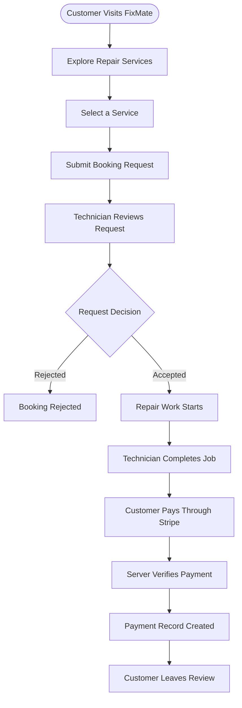

<div align="center">

# 🔧 FixMate

### SMART DEVICE & HOME APPLIANCE REPAIR PLATFORM

**Find. Book. Repair. Pay.**

A modern full-stack repair service platform connecting customers with skilled technicians through a simple, secure, and intelligent booking experience.

<br />

[](https://fixmate-client-wheat.vercel.app/)
[](https://github.com/devnadiaa/fixmate-client)
[](https://github.com/devnadiaa/fixmate-server)

<br />


</div>

---

## ✨ About The Project

FixMate is a full-stack repair service marketplace designed to make finding and booking repair professionals easier.

Whether someone needs help with a washing machine, refrigerator, television, or another home appliance, FixMate helps them discover available services, book technicians, track repair progress, and complete payments online.

The platform provides three dedicated experiences:

| 👤 Customer | 🛠️ Technician | 🛡️ Admin |
|:---:|:---:|:---:|
| Discover and book services | Publish and manage services | Manage users and services |
| Track repair progress | Handle booking requests | Approve or reject listings |
| Pay and review | Complete repair jobs | Monitor platform activities |

---

## 🌟 Key Features

### 👤 Customer Experience

Everything customers need to find and manage repair services.

| Feature | What It Does |
|---|---|
| 🔐 Authentication | Create an account or sign in using email/password or Google. |
| 🔍 Explore Services | Browse approved repair services from available technicians. |
| 🎯 Search & Filter | Find services by keywords, service mode, and customer ratings. |
| 📋 Service Details | View pricing, descriptions, estimated duration, service area, and technician information. |
| 📅 Book a Service | Submit a repair request for the selected service. |
| 📍 Booking Tracker | Follow the progress of a repair through its booking status. |
| ❌ Booking Cancellation | Cancel bookings when their current status allows it. |
| 💳 Online Payment | Pay securely through Stripe after service completion. |
| 🧾 Payment History | View previous payment records. |
| 📄 PDF Invoice | Generate and download payment invoices. |
| ⭐ Reviews & Ratings | Share feedback after a booking is completed. |
| 👤 Profile Management | Update personal account information. |

### 🛠️ Technician Experience

A dedicated workspace for technicians to manage their repair services and jobs.

| Feature | What It Does |
|---|---|
| ➕ Create Services | Add repair services with descriptions, prices, duration, and service areas. |
| 🖼️ Image Upload | Upload service images using ImgBB. |
| 📩 Service Approval | Submit listings for Admin approval before publication. |
| 🗂️ My Services | View and manage personally created service listings. |
| 🔎 Status Filters | Filter listings by Pending, Approved, Rejected, or All. |
| 📥 Booking Requests | View customer requests for listed services. |
| ✅ Request Management | Accept or reject eligible booking requests. |
| 🔄 Job Management | Update repair progress using available booking actions. |
| 🏁 Complete Jobs | Mark repair work as completed and enter the final amount. |
| ⭐ Customer Feedback | View ratings and reviews from customers. |
| 👤 Profile Management | Maintain technician profile information. |

### 🛡️ Admin Experience

A centralized dashboard for managing the FixMate platform.

| Feature | What It Does |
|---|---|
| 📊 Dashboard Overview | View platform statistics and activity summaries. |
| 👥 User Management | View registered users and change their roles. |
| 🔧 Service Management | Review technician-submitted services. |
| ✅ Service Approval | Approve or reject submitted service listings. |
| 🔍 Service Filters | Filter listings using available status filters. |
| 📅 Booking Management | Monitor booking information and service activity. |
| 💰 Payment Records | View available payment and transaction information. |
| ⭐ Review Oversight | Monitor customer feedback and ratings. |

### 🤖 AI-Powered Assistant

Meet the FixMate AI Assistant, powered by the Google Gemini API.

A floating chat assistant that helps signed-in users understand and navigate the platform.

- **Role-Based Assistance:** Provides relevant guidance for Customers, Technicians, and Admins.
- **Service Recommendations:** Suggests relevant approved and available services using real service data from the database.
- **Repair Guidance:** Offers general troubleshooting suggestions for common appliance problems.
- **Platform Support:** Explains booking, payments, service management, and dashboard features.
- **Privacy Protection:** Refuses requests for another user's private account or booking information.
- **Safety Awareness:** Avoids dangerous repair instructions and recommends professional assistance when needed.

> The AI Assistant provides information and guidance. It does not independently create bookings, process payments, or perform account-management actions.

---

## 🔄 How FixMate Works

A simple workflow from service discovery to payment.



Booking cancellation is also supported when permitted by the current booking status.

---

## 💳 Secure Payment System

FixMate integrates **Stripe** to provide secure online payments.

- Stripe Checkout integration.
- Payment available after booking completion.
- Server-side payment verification.
- Booking ownership validation.
- Stripe webhook event handling.
- Duplicate webhook event prevention.
- Customer payment history.
- Downloadable PDF invoices.

---

## 🔐 Authentication & Security

Security is an important part of the FixMate architecture.

- Better Auth authentication.
- Google OAuth sign-in.
- JWT-based API authentication.
- Server-side token verification.
- Role-based authorization.
- Protected API routes.
- Booking status validation.
- Payment ownership enforcement.
- Secure Stripe webhook handling.
- Protected AI Assistant endpoint.
- Environment-based secret management.

---

## ⚡ More Platform Capabilities

| Feature | Description |
|---|---|
| 🌙 Dark Mode | Switch between Light and Dark themes. |
| 📱 Responsive UI | Optimized layouts for mobile, tablet, and desktop. |
| 🔄 Job Timeline | Track important booking status changes. |
| 📄 PDF Generation | Download payment invoices. |
| 📑 Server Pagination | Load service data in manageable pages. |
| 🔎 Advanced Filtering | Search, filter, and sort service listings. |
| 🔔 Toast Notifications | Get feedback after important actions. |
| ⏳ Loading States | Clear loading feedback during data operations. |
| 🚫 Error Handling | Dedicated error and not-found experiences. |
| 🖼️ Image Hosting | Store service images through ImgBB. |

---

## 🧰 Technology Stack

### Frontend

| Technology | Usage |
|---|---|
| Next.js | React framework and routing |
| React | Component-based UI |
| TypeScript | Type-safe development |
| Tailwind CSS | Responsive styling |
| Better Auth | Client authentication |
| Lucide React | Icons |
| Recharts | Dashboard charts |
| React Hot Toast | Notifications |
| React Toastify | Notifications |
| jsPDF | PDF invoice generation |

### Backend

| Technology | Usage |
|---|---|
| Node.js | JavaScript runtime |
| Express.js | REST API development |
| MongoDB | Database |
| Better Auth | Authentication and sessions |
| JWT / jose | Token verification |
| Stripe | Payment processing |
| Google Gemini API | AI Assistant |
| `@google/genai` | Gemini SDK |
| CORS | Cross-origin communication |
| dotenv | Environment configuration |

### Infrastructure & Services

| Service | Usage |
|---|---|
| Vercel | Application deployment |
| MongoDB Atlas | Cloud database |
| Stripe | Online payments |
| ImgBB | Image hosting |
| Google OAuth | Social authentication |
| Google AI Studio | Gemini API key management |

---

## 🗄️ Database Architecture

FixMate uses **four main application collections** in MongoDB.

| Collection | Responsibility |
|---|---|
| `users` | User accounts, profile information, and roles. |
| `services` | Technician service listings and their details. |
| `bookings` | Customer requests and booking status information. |
| `payments` | Payment transaction records. |

---

## 📁 Project Structure

FixMate is organized into two separate repositories.

### Client Repository

[View Client Source Code](https://github.com/devnadiaa/fixmate-client)

```text
fixmate-client/
│
├── public/
├── src/
│   ├── app/
│   ├── components/
│   └── lib/
│
├── package.json
├── package-lock.json
├── next.config.mjs
├── tsconfig.json
└── README.md
```

### Server Repository

[View Server Source Code](https://github.com/devnadiaa/fixmate-server)

```text
fixmate-server/
│
├── src/
│   ├── middlewares/
│   ├── index.js
│   └── aiAssistantRoutes.js
│
├── package.json
├── package-lock.json
└── .gitignore
```

---

## 🚀 Getting Started

Follow the instructions below to run FixMate locally.

### Prerequisites

Make sure you have:

- Node.js and npm
- Git
- MongoDB Atlas account or MongoDB database
- Stripe API credentials
- ImgBB API key
- Google OAuth credentials (for Google sign-in)
- Google Gemini API key (for the AI Assistant)

### 1. Clone the Client

```bash
git clone https://github.com/devnadiaa/fixmate-client.git

cd fixmate-client
```

### 2. Install Client Dependencies

```bash
npm install
```

### 3. Configure Client Environment

Create a `.env.local` file in the client root directory.

```env
NEXT_PUBLIC_BACKEND_URL=http://localhost:5000
NEXT_PUBLIC_IMGBB_API_KEY=your_imgbb_api_key
```

Replace the placeholder with your actual ImgBB API key.

### 4. Start the Client

```bash
npm run dev
```

Client URL:

```text
http://localhost:3000
```

### 5. Clone the Server

Open another terminal.

```bash
git clone https://github.com/devnadiaa/fixmate-server.git

cd fixmate-server
```

### 6. Install Server Dependencies

```bash
npm install
```

### 7. Configure Server Environment

Create a `.env` file in the server root directory.

Add the required configuration values:

```env
PORT=5000
CLIENT_URL=http://localhost:3000

MONGODB_URI=your_mongodb_connection_string
DB_NAME=your_database_name

BETTER_AUTH_SECRET=your_better_auth_secret
BETTER_AUTH_URL=http://localhost:5000

STRIPE_SECRET_KEY=your_stripe_secret_key
STRIPE_WEBHOOK_SECRET=your_stripe_webhook_secret

GOOGLE_CLIENT_ID=your_google_client_id
GOOGLE_CLIENT_SECRET=your_google_client_secret

GEMINI_API_KEY=your_gemini_api_key
```

Replace all placeholder values with your own credentials and ensure the variable names match the server configuration.

### 8. Start the Server

Run the development script configured in the server project:

```bash
npm run dev
```

If Nodemon is configured as a directly available command, you can also use:

```bash
nodemon
```

Make sure both applications are running and the client is configured to communicate with the correct backend URL.

---

## 📜 Available Scripts

### Client

| Command | Description |
|---|---|
| `npm run dev` | Start development server |
| `npm run build` | Create production build |
| `npm start` | Start production server |

### Server

Use the development and production scripts configured in the server's `package.json`.

---

## 🔑 Demo Accounts

Explore the platform using the following demo accounts.

| Role | Email | Password |
|---|---|---|
| Admin | `admin@fixmate.com` | `FixMate123` |
| Customer | `customer@fixmate.com` | `FixMate123` |
| Technician | `technician@fixmate.com` | `FixMate123` |
| Technician | `technician2@fixmate.com` | `FixMate123` |

> These credentials are provided for project demonstration and evaluation.

---

## 🌍 Live Deployment

<div align="center">

### Experience FixMate Live

[](https://fixmate-client-wheat.vercel.app/)

</div>

| Application | Deployment |
|---|---|
| Frontend | [fixmate-client-wheat.vercel.app](https://fixmate-client-wheat.vercel.app/) |
| Backend | [fixmate-server-bay.vercel.app](https://fixmate-server-bay.vercel.app/) |

The frontend and backend are deployed separately on Vercel.

**Important:** Keep all private credentials, including MongoDB credentials, Better Auth secrets, Stripe keys, and the Gemini API key, in environment variables. Never commit real secrets to GitHub.

---

## 👩‍💻 Developer

<div align="center">

### Nadia Akter

**AI-Driven Full Stack Web Engineer in Training**

Building modern web applications with React, Next.js, TypeScript, Node.js, and AI-powered technologies.

<br />

[](https://github.com/devnadiaa)
[](https://nadia-portfolio-omega.vercel.app/)
[](https://linkedin.com/in/nadia-akter-662992442/)

</div>

---

<div align="center">

### 🔧 FixMate

**Making Repair Services Easier, Smarter & More Accessible.**

Built with passion, modern technologies, and a focus on real-world problem solving.

⭐ If you find this project interesting, consider giving it a star!

</div>